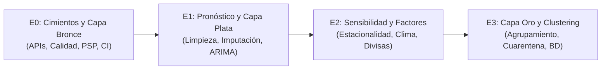

# Propuesta de Proyecto: Observatorio de Datos

## Sistema de Inteligencia de Precios y Costos para el Comercio Minorista Escolar
**Caso de Estudio:** Puestos semifijos de dulces, botanas y bebidas/helados fríos en entornos escolares  
**Región:** Colima, Colima, México  
**Asignatura:** Ingeniería de Datos (ATD-2602)  
**Semestre:** 7mo Semestre, Ago-Dic 2026  
**Estudiante:** Yair Alejandro Molina Díaz (No. Control: 23460519)  
**Institución:** Tecnológico Nacional de México — Instituto Tecnológico de Colima  

---

## 1. Ficha Técnica del Proyecto

| Parámetro | Detalle Institucional y Operativo |
| :--- | :--- |
| **Título del Proyecto** | Observatorio de Datos de Precios e Insumos en Comercio Escolar Minorista |
| **Sector Económico** | Comercio al por menor de dulces, botanas empaquetadas, preparados y helados/bebidas frías en puestos semifijos y ambulantes escolares (SCIAN 461110 / 461121). |
| **Delimitación Geográfica** | Zona metropolitana de Colima-Villa de Álvarez, Estado de Colima, México. |
| **Pregunta Detonadora** | ¿Cómo evolucionan temporalmente los costos de los insumos clave y la canasta de mercancías frente a la inflación y estacionalidad climática, y en qué momentos del año conviene anticipar compras al mayoreo para maximizar el margen de ganancia de los vendedores escolares? |
| **Cliente / Usuario Meta** | Microcomerciantes independientes, expendedores de puestos semifijos y cooperativas escolares de educación básica y media superior en el estado de Colima. |
| **Unidad de Medida / Análisis** | Series de tiempo mensuales y diarias de índices de precios al consumidor (INPC base 2da quincena de julio 2024 = 100) y tipo de cambio FIX. |
| **Horizonte Temporal** | Análisis retrospectivo multi-anual ($\ge 36$ periodos mensuales, series históricas continuas de 1969/1982 a septiembre de 2026). |

### 1.1. Justificación y Contexto Socioeconómico
En el estado de Colima, el comercio minorista semifijo ubicado en las inmediaciones de los planteles escolares representa una fuente fundamental de autoempleo e ingreso para cientos de familias. Este modelo de micronegocio se caracteriza por operar en condiciones de alta vulnerabilidad financiera:
1. **Falta de poder de negociación:** Los comerciantes compran insumos en tiendas de autoservicio de mayoreo (principalmente Sam's Club o distribuidores locales) a precios de mostrador, absorbiendo inmediatamente cualquier choque inflacionario o variación en el costo del azúcar, plásticos, jarabes y lácteos.
2. **Vulnerabilidad estacional dual:** Enfrentan una estacionalidad climática severa (altas temperaturas durante primavera-verano que disparan la demanda de líquidos fríos y nieves) contrapuesta a una estacionalidad administrativa crítica (suspensión de ingresos durante los periodos vacacionales oficiales de la SEP).
3. **Gestión reactiva de inventarios:** La compra de mercancía se ejecuta por agotamiento físico ("cuando se acaba la caja"), careciendo de herramientas analíticas que anticipen alzas de precios o ventanas óptimas de compra.

El presente Observatorio de Datos busca proveer una infraestructura automatizada de datos confiables (Trusted Data) que sirva de base empírica para la toma de decisiones estratégicas de abastecimiento en este sector.

---

## 2. Investigación Primaria: Entrevista de Campo

Para fundamentar el diseño del observatorio en necesidades reales, se realizó una entrevista cualitativa en campo a una comerciante activa del sector en la ciudad de Colima.

### 2.1. Protocolo Ético y Ficha de Levantamiento
* **Sujeto entrevistado:** Comerciante de puesto semifijo exterior de plantel escolar (se omite su identidad y ubicación exacta en estricto cumplimiento de los principios de confidencialidad y protección de datos personales).
* **Modalidad y medio:** Presencial, diálogo estructurado en el punto de venta.
* **Duración:** Aproximadamente 17 minutos.
* **Fecha de levantamiento:** Noviembre de 2026.
* **Consentimiento:** Verbal informado previo a la sesión, autorizando el uso académico de la información de operación comercial sin fines de divulgación de datos sensibles.

### 2.2. Guía Estructurada de Entrevista y Respuestas

| # | Pregunta Estructurada | Respuesta Obtenida (Síntesis de Campo) |
| :---: | :--- | :--- |
| **1** | **¿Cuáles son los productos que le generan mayor volumen de venta e ingresos?** | Su producto estrella son los *jugos preparados* (jugo comercial congelado en caja de cartón al que se le agregan gomitas, chile en polvo tipo Miguelito y salsa chamoy) y la *nieve de sabores en cono*. Las botanas saladas y dulces secos tienen venta constante pero menor margen. |
| **2** | **¿Bajo qué criterio decide qué productos comprar, en qué cantidad y con qué proveedor?** | No cuenta con un calendario formal de compras. Adquiere sus insumos por cajas cerradas en la tienda de mayoreo *Sam's Club* exclusivamente cuando nota que el producto se le agota en su inventario físico del día a día. |
| **3** | **¿Cuál es la principal incertidumbre o factor de riesgo que afecta la estabilidad de su negocio?** | Las suspensiones de clases y los periodos vacacionales oficiales (Semana Santa, verano y fin de año). Al no haber alumnos ni personal escolar, la afluencia de clientes cae a cero y se ve forzada a pausar las ventas y subsistir con ahorros. |
| **4** | **¿En qué épocas del año percibe picos altos y bajos de demanda, y cómo se prepara?** | Su pico máximo de ventas ocurre durante los meses de calor intenso (primavera y verano), donde los productos helados y congelados tienen alta rotación. En invierno las ventas de frío caen, compensando levemente con botanas y dulces. A pesar de notar este patrón, no realiza compras anticipadas ni almacena insumos de forma preventiva. |
| **5** | **¿Qué tipo de información económica o de mercado le resultaría de utilidad práctica?** | Alertas y seguimiento de promociones, descuentos por volumen y tendencias de precios de sus insumos clave (azúcar, refrescos, concentrados, dulces y desechables), para saber cuándo Sam's Club o los proveedores mayoristas ofrecen rebajas reales y surtirse en grandes lotes antes de que suban. |

### 2.3. Síntesis de Aprendizajes de Ingeniería de Datos
De los testimonios recolectados se derivan cuatro directrices de modelado:
1. **La demanda responde a un ciclo combinado bi-factorial:** Estacionalidad climática (temperatura / sensación térmica) modulada estrictamente por el calendario del ciclo escolar.
2. **Inexistencia de compras preventivas:** El aprovisionamiento opera bajo un esquema puramente *just-in-time* reactivo.
3. **Transmisión directa de precios al mayoreo:** Cualquier incremento en los índices de precios al consumidor de mercancías alimenticias afecta directamente la rentabilidad, ya que el comerciante difícilmente puede trasladar de inmediato el incremento al precio final cobrado a los estudiantes.
4. **Oportunidad de analítica prescriptiva:** Se requiere modelar proyecciones de precios y patrones de covarianza entre grupos de mercancías para transformar la intuición del vendedor en ventanas tácticas de reabastecimiento.

---

## 3. Formulación de Preguntas Analíticas del Observatorio

A partir de la necesidad identificada en campo, se formulan tres preguntas analíticas formales que guiarán las fases de ingeniería de datos (E1, E2 y E3):

```
       [Entrevista de Campo] ──► Necesidad de anticipar precios mayoristas
                                           │
         ┌─────────────────────────────────┼─────────────────────────────────┐
         ▼                                 ▼                                 ▼
   [Etapa E1: Pronóstico]         [Etapa E2: Factores]             [Etapa E3: Grupos]
¿Cuál será el índice de pre-   ¿Cómo influyen temporada, in-   ¿Qué grupos de mercancías
cios en los próximos meses?    flación y divisas en insumos?   se mueven de forma sincrónica?
```

### 3.1. Etapa E1 (Pronóstico de Series de Tiempo)
* **Pregunta Analítica:**  
  *¿Cuál será la trayectoria y el valor estimado del índice de precios de las mercancías y agropecuarios en el horizonte de los próximos 3 a 6 meses?*
* **Fundamentación Técnica:**  
  Mediante modelos autorregresivos (ARIMA / SARIMA / Holt-Winters), se proyectará el comportamiento del subíndice de *Mercancías* (INEGI `910394`) y de *Agropecuarios* (INEGI `910397`).
* **Conexión con la Entrevista:**  
  La comerciante compra por cajas en club de precios. Conocer la tendencia esperada a corto plazo permite decidir si comprar inventario extra hoy o postergar la adquisición para evitar comprar en picos inflacionarios locales.

### 3.2. Etapa E2 (Análisis Causal y Sensibilidad a Factores Explicativos)
* **Pregunta Analítica:**  
  *¿En qué medida la estacionalidad del año (verano cálido vs. invierno templado), la inflación general subyacente y las fluctuaciones del tipo de cambio impactan el ritmo de incremento de los costos de los insumos comerciales?*
* **Fundamentación Técnica:**  
  Evaluación econométrica y de descomposición estacional (Classical Seasonal Decomposition / STL) cruzando el subíndice mensual de Banxico (`SP74625`), la serie de tipo de cambio FIX (`SF43718`) y las series de INEGI.
* **Conexión con la Entrevista:**  
  La comerciante reportó una asimetría marcada de ingresos entre verano e invierno. Determinar cuantitativamente si los insumos también se encarecen en verano ayuda a aislar el margen neto real por temporada.

### 3.3. Etapa E3 (Segmentación y Agrupamiento de Productos Afines)
* **Pregunta Analítica:**  
  *¿Qué canastas o subconjuntos de productos (mercancías alimentarias, bebidas preparadas, insumos agropecuarios y servicios comerciales) presentan dinámicas de volatilidad y co-movimiento similares a lo largo del año?*
* **Fundamentación Técnica:**  
  Aplicación de algoritmos de clustering no supervisado (K-Means / Dynamic Time Warping sobre series temporales normalizadas) para agrupar comportamientos de precios.
* **Conexión con la Entrevista:**  
  Sus productos clave son combinados (nieve + jugo congelado + confitería). Identificar qué insumos suben de precio de forma coordinada permite diseñar estrategias de sustitución o promociones combinadas inteligentes.

---

## 4. Plan de Datos Oficiales y Factibilidad Técnica

Para garantizar reproducibilidad y rigor metodológico, el observatorio prescinde de métodos invasivos de extracción web (scraping a tiendas privadas) y se alimenta exclusivamente de APIs REST oficiales con autenticación formal.

### 4.1. Catálogo de Series Seleccionadas

| Fuente | Clave Oficial | Nombre Literal del Catálogo (`CL_INDICATOR`) | Periodicidad | Cobertura Temporal | Observaciones Continuas | Meses Faltantes |
| :--- | :---: | :--- | :---: | :---: | :---: | :---: |
| **INEGI** | `910392` | Índice general | Mensual | 1969/01 – 2026/09 | 693 | 0 |
| **INEGI** | `910394` | Mercancías | Mensual | 1982/01 – 2026/09 | 537 | 0 |
| **INEGI** | `910395` | Servicios | Mensual | 1982/01 – 2026/09 | 537 | 0 |
| **INEGI** | `910397` | Agropecuarios | Mensual | 1982/01 – 2026/09 | 537 | 0 |
| **Banxico** | `SP74625` | Índice de Precios al Consumidor Subyacente Mensual | Mensual | 1969/01 – 2026/09 | 693 | 0 |
| **Banxico** | `SF43718` | Tipo de cambio Pesos por Dólar E.U.A. FIX | Diaria hábil | 1991/11 – 2026/11 | 8,794 | 0 |

> **Nota de integridad del catálogo:**  
> Las claves anteriores pertenecen a la **Actualización de la Canasta y Ponderadores del INPC 2024** (Tema 189113, Fuente 3371 del INEGI). Se verificó en vivo que cada serie mensual cuenta con más de 530 periodos continuos, superando con holgura el umbral mínimo obligatorio de 36 observaciones.

### 4.2. Descarte Técnico de Series No Aptas
1. **Descarte de rama legada INEGI (`628xxx`):** Las series del INPC base 2018 anteriores fueron congeladas en julio de 2024 y carecen del registro de junio de 2024. Se descartaron por discontinuidad.
2. **Descarte de series EMIM (`7xxxxx`):** Se identificó que las series `706027`, `706309` y `704122` corresponden a encuestas manufactureras que miden horas trabajadas y personal ocupado, no niveles de precios.
3. **Descarte de duplicidad Banxico (`SP1`):** Se eliminó la serie `SP1` de Banxico por tratarse del mismo INPC General que ya reporta la serie `910392` del INEGI.

---

## 5. Marco Ético, Legal y Políticas de Extracción

El proyecto implementa un protocolo estricto de gobernanza de datos y ciudadanía digital:

### 5.1. Licenciamiento y Términos de Uso
* **INEGI:** Amparado bajo el decreto del *Decreto de Libre Uso de la Información Pública Gubernamental*. La información es de dominio público y de uso irrestricto con fines académicos y de investigación, condicionada a la adecuada citación de la fuente.
* **Banco de México (SIE):** El Servicio de Información Económica permite la consulta automatizada mediante API para análisis sin fines de reventa directa de bases de datos.

### 5.2. Protocolo Técnico de Extracción Responsable
* **Cero Scraping Invasivo:** No se ejecutan crawlers ni scrapers HTML contra plataformas de comercio minorista ni se evaden mecanismos CAPTCHA.
* **Trazabilidad HTTP y User-Agent:** Cada solicitud HTTP incorpora una cabecera institucional identificable:  
  `User-Agent: ObservatorioEscolarColima/1.0 (Contacto: investigacion-escolar@colima.edu.mx)`.
* **Pausas Éticas (Rate Limiting):** Se aplican intervalos deliberados de descanso de 2.0 segundos entre llamadas sucesivas a las APIs para mitigar cualquier sobrecarga en los servidores públicos.
* **Gestión Segura de Secretos:** Los tokens de acceso (`INEGI_API_TOKEN` y `BANXICO_API_TOKEN`) residen exclusivamente en variables de entorno locales protegidas por `.gitignore` y en GitHub Secrets para flujos de integración continua (CI/CD). Ninguna credencial se commitea en el repositorio.

---

## 6. Distinción Metodológica: Hechos Oficiales vs. Hipótesis

Para preservar la integridad científica del Observatorio, se delimita explícitamente la evidencia factual de las conjeturas de trabajo:

1. **Hecho Oficial Comprobado:**  
   El INEGI actualizó la canasta del INPC a partir de la segunda quincena de julio de 2024 (Tema 189113), trasladando el seguimiento de precios a los subíndices de la familia `910xxx`.
2. **Hecho Oficial Comprobado:**  
   Las series seleccionadas (`910392`, `910394`, `910395`, `910397`, `SP74625` y `SF43718`) poseen datos históricos íntegros y continuos sin ningún mes faltante hasta septiembre de 2026.
3. **[HIPÓTESIS TÉCNICA]:**  
   Se plantea como hipótesis que el salto observado en las series `628xxx` en junio de 2024 se debió a una migración técnica no sincronizada en las tablas históricas legadas durante el despliegue de la canasta 2024.
4. **[HIPÓTESIS ECONÓMICA]:**  
   Se plantea como hipótesis de negocio que la variación acumulada del subíndice de *Mercancías* (`910394`) guarda una correlación estadísticamente significativa ($r > 0.70$) con los incrementos de precios de confitería y refrescos comercializados en Sam's Club Colima.

---

## 7. Plan de Trabajo y Cronograma de Entregas (E0 a E3)



* **Entrega E0 (Fase Actual):** Establecimiento del repositorio, propuesta metodológica integral, análisis ético/legal, desarrollo del extractor automatizado en Python, validación de la capa bronce ($\ge 36$ periodos continuos sin faltantes), workflow semanal en GitHub Actions y registros de calidad PSP.
* **Entrega E1 (Limpieza y Pronóstico):** Construcción de la capa plata, transformación de tipos, análisis exploratorio univariado y entrenamiento de modelos de pronóstico temporal sobre insumos clave.
* **Entrega E2 (Modelado Multivariado):** Cuantificación de efectos estacionales climáticos, elasticidades de precios frente a inflación subyacente y tipo de cambio.
* **Entrega E3 (Capa Oro y Resiliencia):** Modelo dimensional relacional en base de datos relacional, implementación de zona de cuarentena con Pydantic y defensa técnica del proyecto.
